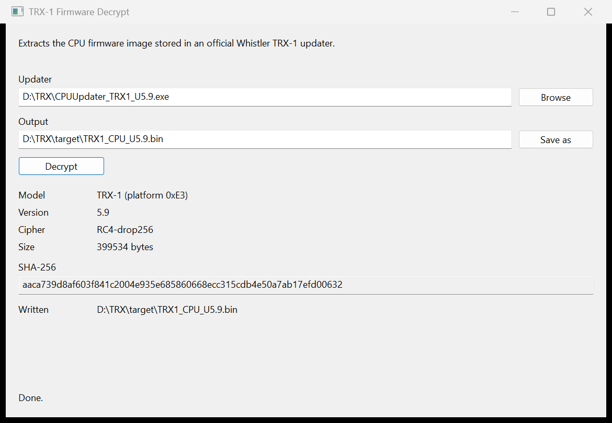

# whistler-trx1-decrypt

Remove the updater cipher from the firmware image carried by an official Whistler TRX-1 CPU updater executable.

The updater is the GRE / Whistler CPUUpdater, file version 0.0.1.4. It is a PE32 program. The image is not a resource. It sits in `.rdata` as a short header, a 64-byte salt, and the payload. This tool reads the header, selects the static key the same way the updater does, builds the same RC4 state, and writes the bytes the updater would send to the scanner.

The program does not embed key material or fixed addresses. The key and the header location are read from the updater executable.

## Build

Requires a Rust toolchain. No crates are fetched.

```text
cargo build --release
```

The binary is `target/release/whistler-trx1-decrypt.exe`.

## Window

Version 1.0 opens a window when the program is started with no arguments. Double-clicking the exe is that case.

The window title is `TRX-1 Firmware Decrypt`.



Browse selects the updater executable. The updater can also be dropped onto the window. The first dropped file is used.

The output path starts as the updater's file stem with `.bin`, in the same directory. Save as, or typing in the output field, chooses a different path. After the user edits that field, picking a new updater does not replace it.

Decrypt reads the updater, writes the image, and shows the model, the version, the cipher, the byte count, the SHA-256 of the output, and the path written.

If the output file already exists, the program asks `Replace the existing file?` and does not write on No.

Errors are shown in a dialog and on the status line. Success status is `Done.`

Enter activates Decrypt. Escape closes the window.

A release build does not open a console window when started with no arguments. Passing an updater on the command line still prints to the console when one is attached.

## Run

Arguments select the command line. No arguments select the window.

```text
whistler-trx1-decrypt <updater.exe> [-o output.bin]
```

If `-o` is omitted, the output is written in the same directory as the updater, with the same file stem and the extension `.bin`.

Stdout is six lines. Errors go to stderr and the process exits 1.

```text
> whistler-trx1-decrypt CPUUpdater_TRX1_U5.9.exe -o TRX1_CPU_U5.9.bin
model: TRX-1 (platform 0xE3)
version: 5.9
cipher: RC4-drop256
bytes: 399534
sha256: aaca739d8af603f841c2004e935e685860668ecc315cdb4e50a7ab17efd00632
wrote: TRX1_CPU_U5.9.bin
```

`cipher` is `none` when the header disables the cipher. `sha256` is the SHA-256 of the output only.

## Updater layout

The header is 8 bytes. The salt and the payload follow it. In `CPUUpdater_TRX1_U5.9.exe` the header is at file offset `0x1A618`, VA `0x41A618`, image base `0x400000`.

| Offset | Size | Field                                                        |
| ------ | ---- | ------------------------------------------------------------ |
| 0      | 1    | Platform byte. `0xE3` is TRX-1.                              |
| 1      | 1    | Version, one BCD byte. `0x59` is 5.9.                        |
| 2      | 2    | Zero.                                                        |
| 4      | 4    | Little-endian length. Low 24 bits are the image size. Bit 31 set disables the cipher. |
| 8      | 64   | Salt.                                                        |
| 72     | n    | Image, `n` = length.                                         |

The salt is not counted in the length. When bit 31 is set, the updater sends the salt and the image unchanged, `n + 64` bytes. The tool writes those bytes and reports `cipher: none`.

## Key selection

The updater has one key-select routine. It reads the platform byte, subtracts `0xE0`, returns null if the result is above 10, and otherwise jumps through an 11-entry table. Each case loads the address of one 64-byte static key.

The tool finds that routine in `.text` by a 27-byte pattern. It must match exactly once. `xx` bytes are operands and are not matched.

```text
A1 xx xx xx xx        mov  eax, [header]
25 FF 00 00 00        and  eax, 0FFh
05 xx xx xx xx        add  eax, imm32
83 F8 xx              cmp  eax, imm8
77 xx                 ja   rel8
FF 24 85 xx xx xx xx  jmp  [table + eax*4]
```

The load gives the header address. The `add` gives the first platform, the `cmp` the last table index, and the `ja` the default case. Each case the platform reaches must be `B8 imm32 C3` (`mov eax, key` / `ret`), which gives the key address, or `33 C0 C3` (`xor eax, eax` / `ret`), which is no key. Any other case is an error. Virtual addresses are converted with the PE image base and the section table. Addresses outside the image are rejected.

The platform byte in the header must be `0xE0` to `0xEE`.

| Platform | Model       | Cipher |
| -------- | ----------- | ------ |
| `0xE0`   | TRX-2e      | yes    |
| `0xE1`   | TRX-1e      | yes    |
| `0xE2`   | TRX-2       | yes    |
| `0xE3`   | TRX-1       | yes    |
| `0xE4`   | PRO-668     | yes    |
| `0xE5`   | unknown     | no     |
| `0xE6`   | WS1080/1088 | yes    |
| `0xE7`   | PRO-651/652 | no     |
| `0xE8`   | WS1040/1065 | no     |
| `0xE9`   | unknown     | no     |
| `0xEA`   | WS1095/1098 | yes    |
| `0xEE`   | PSR-800     | no     |

PRO-668 and WS1080/1088 share one key. A platform with no key is sent without the cipher.

Only the TRX-1 updater has been tested. An updater for another model in this table should work if it uses the same layout and the same key-select routine.

## Cipher

1. Copy the 64-byte salt and XOR it with the 64-byte static key. The result is the RC4 key.
2. RC4 key schedule over that 64-byte key. The key index is `i & 63`.
3. Run the PRGA for 256 bytes and discard them (RC4-drop256).
4. XOR the image with the continuing keystream. The updater does this in 64-byte chunks as it sends them. The state is not reset between chunks.

The salt is not transmitted. It only mixes the RC4 key.

On the wire each chunk is hex-encoded with uppercase digits and framed as STX (`0x02`), hex, ETX (`0x03`), and a one-byte checksum. The port is 115200 baud, 8 data bits, no parity, 1 stop bit. A header packet comes first: STX, the platform byte, the low 24 bits of the length as six hex digits, ETX, and the checksum.

## What the output is

The output is the image after the updater's RC4 layer, before hex encoding. These are the bytes the scanner receives.

It is not a raw CPU flash dump. Entropy is about 7.99 bits per byte. There is no version string and no readable text. A further transform, if the scanner's bootloader applies one, is not in the updater and is not recovered here.

Ruled out for that inner layer:

- AES. There is no AES S-box in the updater.
- The older GRE repeating CRC-16 table XOR. No CRC-16 table is in the updater, and generated tables for polynomials `0x1021`, `0x8005`, `0x8408`, and `0xA001`, in several indexing schemes, give no version byte `0x59` and no readable version string.
- zlib, raw deflate, and LZMA.
- RC4 with the other static keys, with and without the salt XOR, with drop counts 0, 256, and 512.

## Check

| File                       | Bytes   | SHA-256                                                            |
| -------------------------- | ------- | ------------------------------------------------------------------ |
| `CPUUpdater_TRX1_U5.9.exe` | 703728  | `7132ae56c216664ad17942d23b462bd549019b3918f0cedcdaa177287d61cf96` |
| `TRX1_CPU_U5.9.bin`        | 399534  | `aaca739d8af603f841c2004e935e685860668ecc315cdb4e50a7ab17efd00632` |

## Repository layout

```text
src/        Rust source
docs/       Write-up of the updater and the cipher
tools/      Python research scripts used during the analysis
ida/        Hex-Rays output and notes from IDA Professional 9.1
firmware/   Local output folder
```

The vendor updater and the extracted image are not in this repository. Obtain the updater from the vendor and run the tool on it.
